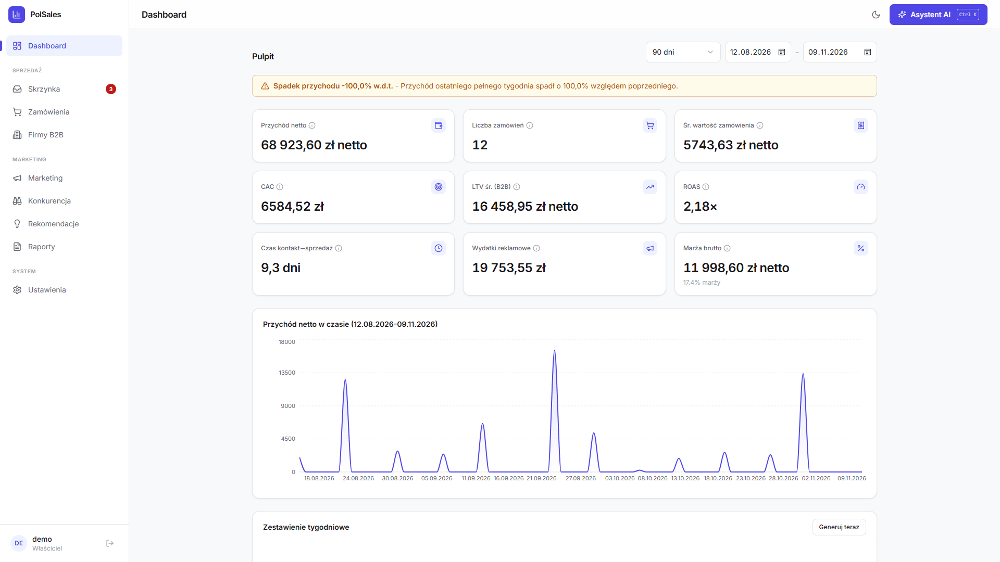

# PolSales

**A sales and marketing analytics panel for a small trading business, with an AI assistant that gets customer data masked by polanon.**

[Wersja polska](README.md)

PolSales brings orders (from the shop, from e-mails and typed in by hand), marketing data
(Meta Ads, organic Facebook/Instagram, Google Ads, GA4) and B2B customers grouped by their
Polish tax ID (NIP) into one place. It computes LTV, CAC, ROAS, margin and the conversion funnel,
and the owner can ask an AI assistant about all of it in plain language: "how is the sports club X
doing?", "which channel has the best ROAS since Thursday 3 pm?".

Before any text reaches a model, personal data is replaced with tokens by
[polanon](https://pypi.org/project/polanon/). The model gets `<FIRMA_1>` and `<NIP_1>`; the owner
sees the real names, restored locally on the server.



## Who it is for

- A small trading business (the demo is a fictional sports shop) that sells B2C and B2B (clubs,
  schools, gyms), takes orders through a website form, by e-mail and by phone, and runs
  campaigns on Meta and Google.
- An owner who wants the numbers in one place and wants to ask an assistant about them, without
  sending customer data to a third-party AI provider in clear text (GDPR).

## Features

| Area | What it does |
|---|---|
| Sales | Orders with line items, VAT, statuses, cancellation; B2B companies by NIP (several people from one company = one profile); LTV, frequency, average order value, COGS and gross margin |
| Inbox | IMAP -> classification -> rule parser (web form) or AI parser (free text, escalating to a stronger model) -> draft for review -> approved into an order; learns product aliases |
| Marketing | Meta Ads, organic FB/IG, Google Ads, GA4; funnel, CAC, ROAS, ad format ranking, organic engagement, product trends from e-mails, competitor comparison |
| AI assistant | Streaming chat (SSE) with 13 read-only tools; the model never writes SQL, tools read only `analytics.*` views as the `assistant_ro` role |
| Privacy | polanon PII masking in chat, the e-mail parser, weekly summaries and recommendations; fail closed |
| Reports | Weekly summaries, action recommendations with number validation (the model may only quote numbers computed by the panel), PDF report |
| Alerts | ROAS < 1, CAC > LTV, week-over-week drop, missing attribution, negative margin - in the panel and by e-mail |
| UI | React + Tailwind, light and dark mode, mobile layout, date ranges, filters, CSV export |

The UI and the domain language are Polish (the target market); code comments mix Polish and English.

## Architecture

```
                browser (React + Vite + TS + Tailwind)
                               │  /api, session cookie, SSE
                               ▼
  Caddy (TLS, CSP) ──► FastAPI (API) ──────────────┐
                          │    │                     │ tokens only
                          │    └─ AI assistant ── polanon ──► model (OpenRouter / Anthropic /
                          │       13 RO tools    (mask, restore)        custom endpoint)
                          ▼
               PostgreSQL 16: core · mail · chat · ops · analytics (views)
                          ▲
  Worker (APScheduler) ───┘  IMAP, ads and GA4 sync, weekly summaries, recommendations,
                             GDPR retention, SMTP notifications
```

- **API and worker** share one codebase (`backend/app`) started with different commands. The
  panel sends commands to the worker through `ops.sync_commands`, so the API never waits on IMAP.
- **Assistant tools** use a separate database session as `assistant_ro`, with a 10 s
  `statement_timeout` and `SELECT` only on `analytics.*` views. Parameters are validated.
  If that role cannot be used (e.g. a database without migrations, or a database account that
  cannot switch to `assistant_ro`), the tools are off: they return an error that points to this
  section, and a warning goes to the log. The assistant never falls back to the application's
  full-privilege session (fail closed). Fix: `alembic upgrade head`, and when the application's
  database account is not a superuser, also `GRANT assistant_ro TO <app_account>`.
- **Integrations degrade gracefully**: a missing key turns off one feature, the rest keeps
  working (e.g. without an AI key the weekly summary is rule-based).
- Design decisions and their reasons (Polish): [`docs/00-decyzje-kanoniczne.md`](docs/00-decyzje-kanoniczne.md),
  data model: [`docs/zrodla/model-danych.md`](docs/zrodla/model-danych.md),
  e-mail pipeline: [`docs/zrodla/pipeline-maili.md`](docs/zrodla/pipeline-maili.md).

## Privacy: polanon

**Why.** The assistant works on customer data: company names, tax IDs, contact people, the text
of order e-mails. Sending that to an external model means handing personal data to a third party.
polanon is my library for reversible masking of Polish personal data (checksum-validated PESEL,
NIP, REGON and IBAN, Polish first and last names in every grammatical case, addresses, phone
numbers, e-mails, companies).

**How it works here** (`backend/app/ai/privacy.py`, `backend/app/services/privacy_settings.py`):

1. Every request to a model (one chat turn, one e-mail, one summary) gets a `Masker` with a
   token -> value mapping that lives only in memory.
2. Everything that goes out is masked: the question, the whole conversation history, tool
   results, the e-mail body, the aggregates for summaries and recommendations. The same person
   gets the same token across the request.
3. The model answers with tokens. Tool call arguments are restored **before** the database is
   queried (`get_company_profile(nip="<NIP_1>")` gets the real NIP), and the answer is restored
   while it streams: a token split across chunks (`<FIR` + `MA_1>`) is buffered, so the user
   never sees half a token.
4. The database and the user see real values; the model gets tokens in place of everything
   polanon detects and everything the panel knows from its database.
5. **Values known from the database are always masked** (polanon `DenylistGuard`): client
   company names (also without the legal form, e.g. "Siłownia Testowa" for "Siłownia Testowa
   Sp. z o.o."), their NIPs (with and without dashes), companies and people from order drafts,
   and contact people - also when a name looks like a well-known brand polanon would let through.
6. **Fail closed**: with masking on, if polanon is missing or fails, nothing is sent to the
   model. The chat shows a message, the e-mail goes to manual review, and summaries and
   recommendations fall back to rules.

Every chat answer carries a "polanon: masked N values" badge (the count includes tool results);
expanding it shows the question exactly as the model received it.

**Settings -> AI privacy**: the masking switch, an optional spaCy NER mode (place names and
surnames beyond the rules) and the polanon install status. Defaults come from
`PII_MASKING_ENABLED` (default `true`) and `PII_MASKING_NER` in `.env`.

## Getting started

### Docker Compose

```bash
cd deploy
cp .env.example .env            # fill in passwords and keys (explained in the comments)
docker compose up -d --build    # db, api, worker, caddy (with the built frontend)
docker compose exec api alembic upgrade head
docker compose exec api python -m app.scripts.create_user
docker compose exec api python -m app.scripts.seed_demo   # optional: fictional demo data
```

Panel: `https://<APP_DOMAIN>` (with `APP_DOMAIN=localhost` Caddy issues a local certificate).
Any `APP_DOMAIN` other than `localhost` turns on production mode: the session cookie is `Secure`
and the app refuses to start with default secrets.

### Local

Requirements: Python 3.10+, Node 22.12+ (CI and Docker: Node 24 LTS), PostgreSQL 16.

```bash
cd backend
python -m venv .venv
source .venv/bin/activate            # Windows: .venv\Scripts\activate
pip install -e ".[dev]"              # includes polanon; NER mode: pip install -e ".[ner]"
export DATABASE_URL=postgresql+psycopg://postgres@127.0.0.1:5432/polsales
alembic upgrade head
python -m app.scripts.create_user
python -m app.scripts.seed_demo      # fictional sports shop: companies, orders, campaigns
uvicorn app.main:app --reload        # API on http://localhost:8000
python -m app.scheduler.runner       # worker (separate terminal)
```

```bash
cd frontend
npm ci
npm run dev                          # http://localhost:5173, proxies /api -> :8000
```

On Windows without Docker or admin rights, `deploy\run-local.ps1` downloads a portable
PostgreSQL, creates the venv and the account, and `run.bat` starts everything.

### Assistant without an API key (mock model)

```bash
python tools/mock_llm.py --port 8765
# backend/.env: AI_BASE_URL=http://127.0.0.1:8765  (no OPENROUTER_API_KEY / ANTHROPIC_API_KEY)
```

The mock implements a slice of the Anthropic Messages API (streaming and tool use) and prints
everything it receives - with masking on, that is tokens only. The demo was recorded on it.

## Configuration

Secrets live only in `.env` (the panel never shows or edits them). Templates:
[`backend/.env.example`](backend/.env.example) (local) and [`deploy/.env.example`](deploy/.env.example) (Docker).

| Variable | Meaning | Without it |
|---|---|---|
| `DATABASE_URL`, `SESSION_SECRET`, `APP_DOMAIN` | database, session signing, domain | dev defaults (production refuses to start) |
| `OPENROUTER_API_KEY` / `ANTHROPIC_API_KEY` | AI provider | no chat or AI parser; rule-based summaries |
| `AI_BASE_URL` | custom Anthropic-compatible endpoint (mock, gateway) | the provider's default URL |
| `CHAT_MODEL`, `EMAIL_PARSER_MODEL` | chat and parser models | `claude-opus-4-8`, `claude-haiku-4-5` |
| `PII_MASKING_ENABLED`, `PII_MASKING_NER` | masking defaults | `true`, `false` |
| `IMAP_*` | order mailbox | no e-mail import |
| `SMTP_*` | e-mail notifications | no notifications |
| `META_*`, `GOOGLE_ADS_*`, `GA4_*` | marketing channels | no data from that channel |
| `CF_ACCESS_*` | optional Cloudflare Access login (JWT verification) | username and password only |
| `CF_ACCESS_ONLY` | Access is the only way in (no password login); recommended behind a tunnel | `false` |
| `RAW_EMAIL_RETENTION_DAYS` | after this many days the worker clears the body, HTML and headers of handled e-mails (GDPR) | no automatic clean-up |

The configuration status (without secret values) is shown on the **Settings** page.

## Tests and quality

```bash
cd backend && ruff check . && pytest -q -W error   # 256 tests, warnings are errors
cd frontend && npm test && npm run build           # 17 tests, typecheck (app and config), build
```

Backend tests need PostgreSQL (`DATABASE_URL`). Masking is tested at three levels:

- `tests/test_privacy.py` - the contract with a fake anonymizer: what the model sees, what the
  tools get, what the user sees and what is stored; fail closed when polanon breaks (also in the
  middle of the tool loop); e-mail parser, summaries, recommendations and the settings API.
- `tests/test_polanon_real.py` - the same scenarios with the real polanon, including a client
  named like a well-known brand and a NIP alone in a tool result field.
- `tests/test_mock_llm_e2e.py` - the real Anthropic SDK -> the local mock model over HTTP: checks
  that requests leaving the server contain tokens only.
- `tests/test_security.py` - fixes from the security review: CSRF, request body limit, login
  limits, Cloudflare Access only mode, secrets scrubbed from error messages.

CI (GitHub Actions) on Linux and Windows: ruff (incl. security rules), migrations on a clean PostgreSQL, backend tests
(with polanon), frontend tests and build.

## Project layout

```
polsales/
├── backend/
│   ├── app/
│   │   ├── ai/            # AI client, assistant loop, 13 tools, masking (privacy.py)
│   │   ├── api/           # FastAPI endpoints
│   │   ├── db/            # SQLAlchemy models (core, mail, chat, ops schemas)
│   │   ├── integrations/  # IMAP, Meta, Google Ads, GA4
│   │   ├── scheduler/     # APScheduler worker
│   │   ├── scripts/       # create_user, seed_demo
│   │   └── services/      # metrics, e-mail pipeline, parsers, PDF reports, recommendations, privacy
│   ├── alembic/           # migrations (incl. analytics.* views and the assistant_ro role)
│   └── tests/
├── frontend/              # React + Vite + TypeScript + Tailwind
├── deploy/                # docker-compose, Caddyfile, .env.example, backup and start scripts
├── docs/                  # design decisions, metrics, GDPR, integrations, demo.gif
└── tools/mock_llm.py      # local mock model (demo, end-to-end tests)
```

## Known limitations

- Built for a single owner and a scale of hundreds of orders a month: one account, no roles,
  metrics computed by plain views, no server-side pagination of the company list.
- Masking is not an absolute guarantee. The rules (without NER) do not catch every place name or
  unusual surname, and a new customer who is not in the database, has no legal form and no first
  name in their company name can go out in clear. That is why values known from the database
  always go through the list of known values, and NER is available as an option. Product and
  campaign names are not masked.
- No integration with a shop platform (Shopify, WooCommerce, PrestaShop): orders come from
  e-mails and the website form, manual entries and CSV import.
- With masking on, the AI parser gets customer data as tokens, so it cannot fix a typo in a
  company name - it returns what was in the e-mail. Drafts are reviewed by hand anyway.
- Meta, Google Ads and GA4 need your own developer accounts and approved API access; in this
  repository they are tested on sample data, not live accounts.
- The GA4 attribution heuristic for e-mail orders needs live traffic and is not calibrated yet;
  phone and e-mail orders often have no reliable source.
- The `assistant_ro` role restricts the assistant's tools through `SET ROLE` on the application's
  connection, which in Docker Compose is the database owner. The tools never run arbitrary SQL, so
  the role cannot be dropped, but full separation would need a separate login role.
- The Docker Compose setup has not been run on a live server from this repository; CI checks
  the backend and the frontend separately.

## License

[MIT](LICENSE) (c) 2026 BoroMat. Security reports: [SECURITY.md](SECURITY.md).
