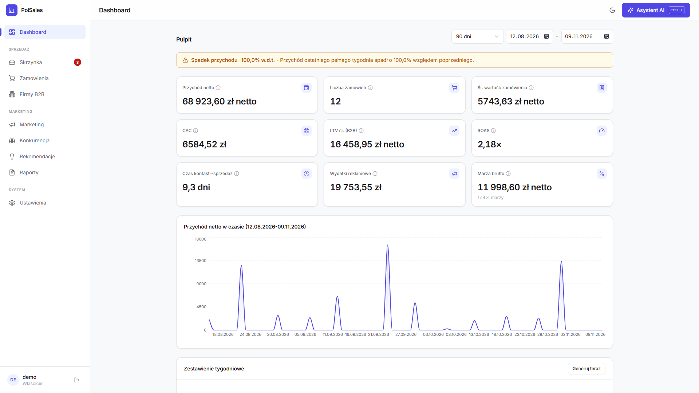

# PolSales

**Panel analityczno-sprzedażowy dla małej firmy handlowej z asystentem AI, który dostaje dane klientów zamaskowane przez polanon.**

[English version](README.en.md)

PolSales łączy w jednym miejscu zamówienia (ze sklepu, z maili i wpisywane ręcznie), dane
marketingowe (Meta Ads, Facebook/Instagram organicznie, Google Ads, GA4) i klientów B2B
grupowanych po NIP. Liczy LTV, CAC, ROAS, marżę i lejek konwersji, a właściciel może o to
wszystko zapytać asystenta AI zwykłym językiem: "jak idzie współpraca z klubem X?",
"który kanał ma najlepszy ROAS od czwartku od 15:00?".

Zanim jakikolwiek tekst trafi do modelu, dane osobowe są zamieniane na tokeny przez
[polanon](https://pypi.org/project/polanon/). Model dostaje `<FIRMA_1>` i `<NIP_1>`, a właściciel
widzi prawdziwe nazwy - odtworzone lokalnie, na serwerze.



## Dla kogo

- Mała firma handlowa (w demo: fikcyjny sklep sportowy), która sprzedaje B2C i B2B (kluby,
  szkoły, siłownie), przyjmuje zamówienia przez formularz na stronie, mailem i telefonicznie
  i prowadzi kampanie w Meta i Google.
- Właściciel, który chce mieć liczby w jednym miejscu i zadawać pytania asystentowi, ale nie
  chce wysyłać danych klientów do zewnętrznego dostawcy AI w jawnej postaci (RODO).

## Co robi

| Obszar | Funkcje |
|---|---|
| Sprzedaż | Zamówienia z pozycjami, VAT, statusy, anulowanie; firmy B2B po NIP (kilka osób z jednej firmy = jeden profil); LTV, częstotliwość, średnia wartość, COGS i marża brutto |
| Skrzynka | IMAP -> klasyfikacja -> parser regułowy (formularz) lub AI (wolny tekst, z eskalacją do mocniejszego modelu) -> szkic do weryfikacji -> zatwierdzenie do zamówienia; uczenie aliasów produktów |
| Marketing | Meta Ads, FB/IG organicznie, Google Ads, GA4; lejek, CAC, ROAS, ranking formatów reklam, zaangażowanie organiczne, trendy produktów z maili, porównanie z konkurencją |
| Asystent AI | Czat ze streamingiem (SSE) i 13 narzędziami tylko do odczytu; model nie pisze SQL, a narzędzia czytają wyłącznie widoki `analytics.*` jako rola `assistant_ro` |
| Prywatność | Maskowanie danych osobowych przez polanon w czacie, parserze maili, zestawieniach i rekomendacjach; fail closed |
| Raporty | Zestawienia tygodniowe, rekomendacje działań z walidacją liczb (model może cytować tylko liczby policzone przez panel), raport PDF |
| Alerty | ROAS < 1, CAC > LTV, spadek tydzień do tygodnia, brak atrybucji, ujemna marża - w panelu i e-mailem |
| Panel | React + Tailwind, tryb jasny i ciemny, wersja na telefon, zakresy dat, filtry, eksport CSV |

## Architektura

```
              przeglądarka (React + Vite + TS + Tailwind)
                               │  /api, cookie sesji, SSE
                               ▼
  Caddy (TLS, CSP) ──► FastAPI (API) ──────────────┐
                          │    │                     │ tylko tokeny
                          │    └─ asystent AI ── polanon ──► model (OpenRouter / Anthropic /
                          │         13 narzędzi RO   (maskuj, odtwórz)      własny endpoint)
                          ▼
                PostgreSQL 16: core · mail · chat · ops · analytics (widoki)
                          ▲
  Worker (APScheduler) ───┘  IMAP, synchronizacja reklam i GA4, zestawienia, rekomendacje,
                             retencja RODO, powiadomienia SMTP
```

- **API i worker** to ten sam kod (`backend/app`), uruchamiany z różnymi poleceniami. Worker
  dostaje polecenia z panelu przez tabelę `ops.sync_commands`, więc API nigdy nie czeka na IMAP.
- **Narzędzia asystenta** mają osobną sesję bazy jako rola `assistant_ro` z `statement_timeout`
  10 s i prawem `SELECT` tylko na widokach `analytics.*`. Parametry są walidowane, model nie pisze SQL.
  Gdy tej roli nie da się użyć (np. baza bez migracji albo konto bazy bez prawa do przełączenia
  się na `assistant_ro`), narzędzia są wyłączone: zwracają błąd z odesłaniem do tej sekcji,
  a w logu jest ostrzeżenie. Asystent nigdy nie przechodzi wtedy na sesję aplikacji z pełnymi
  uprawnieniami (fail closed). Naprawa: `alembic upgrade head`, a gdy konto aplikacji w bazie
  nie jest superużytkownikiem, także `GRANT assistant_ro TO <konto_aplikacji>`.
- **Integracje degradują się łagodnie**: brak klucza oznacza, że dana funkcja jest pomijana,
  a reszta działa (np. bez klucza AI zestawienie tygodniowe liczy się regułami).
- Decyzje projektowe z uzasadnieniem: [`docs/00-decyzje-kanoniczne.md`](docs/00-decyzje-kanoniczne.md),
  model danych: [`docs/zrodla/model-danych.md`](docs/zrodla/model-danych.md),
  pipeline maili: [`docs/zrodla/pipeline-maili.md`](docs/zrodla/pipeline-maili.md).

## Prywatność: polanon

**Dlaczego.** Asystent pracuje na danych klientów: nazwach firm, NIP-ach, osobach kontaktowych,
treści maili z zamówieniami. Wysłanie tego do zewnętrznego modelu to przekazanie danych osobowych
podmiotowi trzeciemu. polanon to moja biblioteka do odwracalnego maskowania polskich danych
osobowych (PESEL, NIP, REGON i IBAN z walidacją sum kontrolnych, imiona i nazwiska w każdym
przypadku, adresy, telefony, e-maile, firmy).

**Jak działa w PolSales** (`backend/app/ai/privacy.py`, `backend/app/services/privacy_settings.py`):

1. Na każde żądanie do modelu (jedna tura czatu, jeden mail, jedno zestawienie) powstaje
   `Masker` z mapowaniem token -> wartość, trzymanym tylko w pamięci.
2. Maskowane jest wszystko, co wychodzi: pytanie, cała historia rozmowy, wyniki narzędzi,
   treść maila, agregaty do zestawień i rekomendacji. Ta sama osoba ma ten sam token w całym żądaniu.
3. Model odpowiada tokenami. Argumenty wywołań narzędzi są odtwarzane **przed** zapytaniem do
   bazy (`get_company_profile(nip="<NIP_1>")` dostaje prawdziwy NIP), a odpowiedź jest odtwarzana
   także w trakcie streamingu - token rozcięty między fragmenty (`<FIR` + `MA_1>`) jest
   buforowany, więc użytkownik nigdy nie widzi połówki tokenu.
4. Baza i użytkownik widzą prawdziwe wartości; model dostaje tokeny w miejscu wszystkiego, co
   rozpozna polanon, i wszystkiego, co panel zna z bazy.
5. **Wartości znane z bazy są maskowane zawsze** (polanon `DenylistGuard`): nazwy firm klientów
   (także bez formy prawnej, np. "Siłownia Testowa" zamiast "Siłownia Testowa Sp. z o.o."),
   ich NIP-y (z kreskami i bez), firmy i osoby ze szkiców zamówień oraz osoby kontaktowe -
   także gdy nazwa wygląda jak znana marka, którą polanon normalnie przepuszcza.
6. **Fail closed**: gdy maskowanie jest włączone, a polanon nie jest zainstalowany albo zgłosi
   błąd, do modelu nie wychodzi nic. Czat pokazuje komunikat, mail trafia do ręcznej weryfikacji,
   a zestawienie i rekomendacje liczą się regułami.

W czacie każda odpowiedź ma odznakę "polanon: zamaskowano N wartości" (licznik obejmuje też
wyniki narzędzi); po rozwinięciu widać pytanie dokładnie w tej postaci, w jakiej dostał je model.

**Ustawienia -> Prywatność AI**: przełącznik maskowania, opcjonalny tryb spaCy NER (dodatkowo
nazwy miejsc i nazwiska spoza reguł) i stan instalacji polanon. Domyślne wartości dają
`PII_MASKING_ENABLED` (domyślnie `true`) i `PII_MASKING_NER` w `.env`.

## Uruchomienie

### Docker Compose

```bash
cd deploy
cp .env.example .env            # uzupełnij hasła i klucze (opis w komentarzach)
docker compose up -d --build    # db, api, worker, caddy (z wbudowanym frontendem)
docker compose exec api alembic upgrade head
docker compose exec api python -m app.scripts.create_user
docker compose exec api python -m app.scripts.seed_demo   # opcjonalnie: fikcyjne dane demo
```

Panel: `https://<APP_DOMAIN>` (dla `APP_DOMAIN=localhost` Caddy wystawia certyfikat lokalny).
Ustawienie `APP_DOMAIN` na coś innego niż `localhost` włącza tryb produkcyjny: ciasteczko sesji
dostaje flagę `Secure`, a aplikacja odmawia startu z domyślnymi sekretami.

### Lokalnie

Wymagania: Python 3.10+, Node 22.12+ (CI i Docker: Node 24 LTS), PostgreSQL 16.

```bash
cd backend
python -m venv .venv
source .venv/bin/activate            # Windows: .venv\Scripts\activate
pip install -e ".[dev]"              # z polanon; tryb NER: pip install -e ".[ner]"
export DATABASE_URL=postgresql+psycopg://postgres@127.0.0.1:5432/polsales
alembic upgrade head
python -m app.scripts.create_user
python -m app.scripts.seed_demo      # fikcyjny sklep sportowy: firmy, zamówienia, kampanie
uvicorn app.main:app --reload        # API na http://localhost:8000
python -m app.scheduler.runner       # worker (osobny terminal)
```

```bash
cd frontend
npm ci
npm run dev                          # http://localhost:5173, proxy /api -> :8000
```

Na Windows bez Dockera i bez uprawnień administratora: `deploy\run-local.ps1` pobiera przenośnego
PostgreSQL (i sprawdza jego sumę SHA256), zakłada venv i konto, a `run.bat` uruchamia całość.

### Asystent bez klucza API (atrapa modelu)

```bash
python tools/mock_llm.py --port 8765
# backend/.env: AI_BASE_URL=http://127.0.0.1:8765  (bez OPENROUTER_API_KEY i ANTHROPIC_API_KEY)
```

Atrapa implementuje fragment Anthropic Messages API (ze streamingiem i tool use) i wypisuje
na konsolę wszystko, co dostaje - widać, że przy włączonym maskowaniu są to same tokeny.
Na niej nagrane jest demo.

## Konfiguracja

Sekrety są wyłącznie w `.env` (panel nigdy ich nie pokazuje ani nie edytuje). Wzorce:
[`backend/.env.example`](backend/.env.example) (lokalnie) i [`deploy/.env.example`](deploy/.env.example) (Docker).

| Zmienna | Znaczenie | Bez niej |
|---|---|---|
| `DATABASE_URL`, `SESSION_SECRET`, `APP_DOMAIN` | baza, podpis sesji, domena | wartości deweloperskie (produkcja odmówi startu) |
| `OPENROUTER_API_KEY` / `ANTHROPIC_API_KEY` | dostawca AI | brak czatu i parsera AI; zestawienia regułowe |
| `AI_BASE_URL` | własny endpoint zgodny z Anthropic API (atrapa, bramka) | domyślny adres dostawcy |
| `CHAT_MODEL`, `EMAIL_PARSER_MODEL` | modele czatu i parsera | `claude-opus-4-8`, `claude-haiku-4-5` |
| `EMAIL_PARSER_ESCALATION_MODEL` | model, do którego parser eskaluje przy pewności poniżej 0,5; wartość równa `EMAIL_PARSER_MODEL` wyłącza eskalację | model czatu |
| `PII_MASKING_ENABLED`, `PII_MASKING_NER` | domyślne ustawienia maskowania | `true`, `false` |
| `IMAP_*` | skrzynka z zamówieniami | brak pobierania maili |
| `SMTP_*` | powiadomienia e-mail | brak powiadomień |
| `META_*`, `GOOGLE_ADS_*`, `GA4_*` | kanały marketingowe | brak danych z kanału |
| `BACKEND_EXTRAS` (Docker) | opcjonalne pakiety w obrazie backendu: `google`, `ner` albo `google,ner` | sam rdzeń |
| `CF_ACCESS_*` | opcjonalne logowanie przez Cloudflare Access (weryfikacja JWT) | tylko login i hasło |
| `CF_ACCESS_ONLY` | wejście wyłącznie przez Access (bez logowania hasłem); zalecane przy tunelu | `false` |
| `RAW_EMAIL_RETENTION_DAYS` | po tylu dniach worker czyści treść, HTML i nagłówki obsłużonych maili (RODO) | bez automatycznego czyszczenia |

Integracje GA4 i Google Ads potrzebują opcjonalnych pakietów Google (extra `google`). Lokalnie:
`pip install -e ".[google]"`. W Dockerze: `BACKEND_EXTRAS=google` w `deploy/.env`, a potem
`docker compose up -d --build`. Bez tych pakietów reszta panelu działa, a skonfigurowana
integracja pokazuje w Ustawieniach i na pulpicie komunikat o brakującym pakiecie zamiast błędu
importu. Integracje Google nie były testowane na żywym koncie (patrz Znane ograniczenia).

Stan konfiguracji (bez wartości sekretów) jest widoczny w zakładce **Ustawienia**.

## Testy i jakość

```bash
cd backend && ruff check . && pytest -q -W error   # 288 testów, ostrzeżenia traktowane jak błędy
cd frontend && npm test && npm run build           # 17 testów, typecheck (aplikacja i konfiguracja), build
```

Testy backendu wymagają PostgreSQL (`DATABASE_URL`). Maskowanie ma trzy warstwy testów:

- `tests/test_privacy.py` - kontrakt z atrapą anonimizatora: co widzi model, co dostają narzędzia,
  co widzi użytkownik i co trafia do bazy; fail closed przy błędzie polanon (także w trakcie
  pętli narzędzi); parser maili, zestawienia, rekomendacje i API ustawień.
- `tests/test_polanon_real.py` - te same scenariusze z prawdziwym polanon, w tym firma klienta
  o nazwie znanej marki i NIP w polu wyniku narzędzia.
- `tests/test_mock_llm_e2e.py` - prawdziwe SDK Anthropic -> lokalna atrapa modelu przez HTTP:
  sprawdza, że żądania wychodzące z serwera zawierają wyłącznie tokeny.
- `tests/test_security.py` - poprawki z przeglądu bezpieczeństwa: CSRF, limit ciała żądania,
  limity logowania, tryb tylko Cloudflare Access, czyszczenie sekretów z komunikatów błędów.

CI (GitHub Actions) na Linux i Windows: ruff (także reguły bezpieczeństwa), migracje na czystej bazie PostgreSQL, testy backendu
(z polanon), testy i build frontendu.

## Struktura

```
polsales/
├── backend/
│   ├── app/
│   │   ├── ai/            # klient AI, pętla asystenta, 13 narzędzi, maskowanie (privacy.py)
│   │   ├── api/           # endpointy FastAPI
│   │   ├── db/            # modele SQLAlchemy (schematy core, mail, chat, ops)
│   │   ├── integrations/  # IMAP, Meta, Google Ads, GA4
│   │   ├── scheduler/     # worker APScheduler
│   │   ├── scripts/       # create_user, seed_demo
│   │   └── services/      # metryki, pipeline maili, parsery, raporty PDF, rekomendacje, prywatność
│   ├── alembic/           # migracje (w tym widoki analytics.* i rola assistant_ro)
│   └── tests/
├── frontend/              # React + Vite + TypeScript + Tailwind
├── deploy/                # docker-compose, Caddyfile, .env.example, skrypty backupu i startu
├── docs/                  # decyzje projektowe, metryki, RODO, integracje, demo.gif
└── tools/mock_llm.py      # lokalna atrapa modelu (demo, testy E2E)
```

## Znane ograniczenia

- Projekt jest skrojony pod jednego właściciela i skalę rzędu setek zamówień miesięcznie:
  brak ról, metryki liczone widokami bez materializacji, lista firm bez paginacji po stronie
  serwera.
- Wszystkie konta, także zakładane automatycznie przez Cloudflare Access dla adresów
  z `CF_ACCESS_ALLOWED_EMAILS`, mają pełne prawa do danych panelu: zamówień, klientów, maili,
  raportów i ustawień. Osobne są tylko rozmowy z asystentem - każde konto widzi wyłącznie własne.
- Maskowanie nie daje gwarancji absolutnej. Reguły (bez NER) nie rozpoznają każdej nazwy miejsca
  ani nietypowego nazwiska, a nowy klient spoza bazy, bez formy prawnej i bez imienia w nazwie,
  może przejść jawnie. Dlatego wartości znane z bazy idą zawsze przez listę znanych wartości,
  a tryb NER jest dostępny jako opcja. Nazwy produktów i kampanii nie są maskowane.
- Brak integracji z platformą sklepu (Shopify, WooCommerce, PrestaShop): zamówienia przychodzą
  z maili i formularza, z wpisów ręcznych i z importu CSV.
- Parser AI z maskowaniem dostaje dane klienta jako tokeny, więc nie poprawi literówki w nazwie
  firmy - zwraca to, co było w treści. Szkic i tak przechodzi ręczną weryfikację.
- Integracje Meta, Google Ads i GA4 wymagają własnych kont deweloperskich i zatwierdzonego
  dostępu do API; w repozytorium są testowane na danych przykładowych, nie na żywych kontach.
- Heurystyka atrybucji GA4 dla zamówień z maili wymaga żywego ruchu i nie jest jeszcze
  skalibrowana; zamówienia telefoniczne i mailowe często nie mają pewnego źródła.
- Rola `assistant_ro` ogranicza narzędzia asystenta przez `SET ROLE` na połączeniu aplikacji, które
  w Docker Compose jest kontem właściciela bazy. Narzędzia nie wykonują dowolnego SQL, więc nie da
  się tej roli porzucić, ale pełna separacja wymagałaby osobnego konta bazy z logowaniem.
- Wariant Docker Compose nie był uruchamiany w tym repozytorium na żywym serwerze; CI sprawdza
  backend i frontend osobno.

## Licencja

[MIT](LICENSE) (c) 2026 BoroMat. Zgłoszenia bezpieczeństwa: [SECURITY.md](SECURITY.md).
