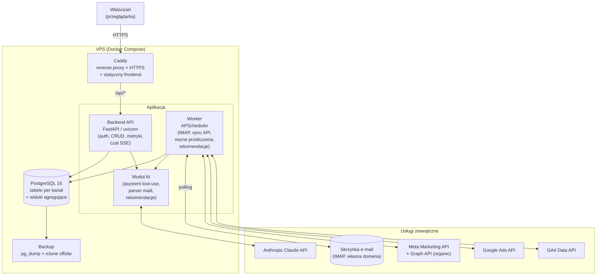

# Architektura systemu i wdrożenie - panel analityki sprzedaży i marketingu

## (a) Diagram komponentów

### Opis komponentów

**1. Frontend (React + Vite, SPA po polsku)** - statyczne pliki budowane Vite, serwowane bezpośrednio przez Caddy. Dwa główne widoki: dashboard (KPI, lejek, statusy synchronizacji, lista zamówień/firm, ręczne dodawanie zamówień) oraz okno czatu z asystentem AI (streaming odpowiedzi przez SSE). Komunikacja wyłącznie z backendem po `/api/*` - ta sama domena, brak problemów CORS.

**2. Backend API (FastAPI, uvicorn)** - bezstanowe REST API + endpoint czatu. Odpowiada za: auth, CRUD zamówień/firm (wpisy ręczne), odczyt metryk i widoków zagregowanych, endpoint `/api/chat` (pętla tool-use z Claude API, streaming SSE do frontendu), endpoint `/api/health/integrations` (statusy synchronizacji dla dashboardu). Nie wykonuje zadań cyklicznych.

**3. Worker (ten sam obraz co backend, osobny proces/kontener)** - APScheduler z zadaniami: polling IMAP, synchronizacje API reklamowych, nocne przeliczanie metryk, dzienna generacja rekomendacji AI. Współdzieli kod (`app/`) i bazę z API, ale działa w osobnym kontenerze.

**4. PostgreSQL 16** - jedna baza, dane kanałów w odseparowanych tabelach (`meta_ads_*`, `meta_organic_*`, `google_ads_*`, `ga4_*`, `orders`, `companies`, `emails_raw`...) + widoki SQL agregujące całość (`v_marketing_daily`, `v_funnel`, `v_company_ltv` itd. - szczegóły w gestii projektanta bazy). Dodatkowo tabele operacyjne: `sync_runs` (log przebiegów synchronizacji), `sessions`, `chat_messages`.

**5. Warstwa AI (moduł `ai/` używany przez API i workera)** - trzy zastosowania Claude API (oficjalny SDK `anthropic`):
- **Asystent-analityk** (wywoływany z `/api/chat`): pętla tool-use; narzędzia to funkcje zapytań do bazy (`query_orders`, `get_metrics`, `get_funnel`, `get_channel_stats`, `run_readonly_sql` na roli read-only itd.).
- **Parser maili** (wywoływany z workera): ekstrakcja strukturalna (structured outputs, `output_config.format` + schemat JSON) danych zamówienia z maila - zarówno z formatu formularza (parsowany najpierw regexem, LLM jako fallback), jak i z wolnego tekstu: pozycje, kwoty netto/VAT, NIP, dane klienta.
- **Silnik rekomendacji** (worker, 1×/dobę): analiza wskaźników postów/reklam z ostatniego okresu i zapis rekomendacji treściowych do tabeli `recommendations`, wyświetlanych na dashboardzie.

**6. Integracje zewnętrzne (moduł `integrations/`, wywoływane przez workera)**:
- **IMAP** (`imap-tools`) - polling skrzynki na własnej domenie, śledzenie UID/UIDVALIDITY, zapis surowego maila do `emails_raw`, przekazanie do parsera.
- **Meta Marketing API** - kampanie płatne FB/IG (wydatki, wyświetlenia, kliknięcia, CPM/CPC).
- **Meta Graph API (Pages + Instagram Insights)** - zasięgi/interakcje postów organicznych.
- **Google Ads API** - kampanie płatne Google (koszt, wyświetlenia, kliknięcia).
- **GA4 Data API** - sesje, źródła ruchu, zdarzenia na stronie (do lejka: kliknięcia → sesje).

**7. Caddy** - reverse proxy, automatyczne HTTPS (Let's Encrypt), serwowanie statycznego frontendu, nagłówki bezpieczeństwa, proxy `/api/*` → FastAPI.

### Diagram (mermaid)



---

## (b) Ostateczny dobór stacku (potwierdzenie z korektami)

Wstępny kierunek **potwierdzony** z następującymi uściśleniami i korektami:

| Warstwa | Wybór | Uzasadnienie |
|---|---|---|
| Backend | **Python 3.12 + FastAPI** | Potwierdzone. Najlepszy ekosystem do integracji (oficjalne SDK Google Ads, GA4, Anthropic są pythonowe), async pasuje do streamingu czatu (SSE) i I/O-bound synchronizacji. Pydantic v2 do walidacji. |
| ORM / migracje | **SQLAlchemy 2.0 + Alembic** | Standard; Alembic zarządza też tworzeniem widoków (migracje z `CREATE OR REPLACE VIEW`). |
| Baza | **PostgreSQL 16** | Potwierdzone. Widoki + ewentualnie materialized views do nocnych agregatów; JSONB na surowe payloady API i maile; window functions do LTV/częstotliwości. SQLite odrzucone (współbieżny dostęp API+worker, widoki analityczne). |
| Frontend | **React 18 + Vite + TypeScript + Tailwind CSS + Recharts** | Potwierdzone; TS obowiązkowo (kontrakty typów z API), Recharts do wykresów lejka/trendów - lekki, wystarczający. Bez Next.js - SPA za Caddy w zupełności wystarcza, zero SSR. |
| Zadania cykliczne | **APScheduler w osobnym procesie workera** (korekta - szczegóły w pkt. d) | Bez Celery/Redis - overkill przy tej skali; jeden broker mniej do utrzymania. |
| AI | **Oficjalny SDK `anthropic`**; model asystenta: `claude-opus-4-8` (adaptive thinking, tool use, prompt caching); parser maili: `claude-haiku-4-5` ze structured outputs | Opus 4.8 jako analityk - jakość wnioskowania na danych i wielokrokowe tool-use; Haiku 4.5 do ekstrakcji z maili - zadanie proste i powtarzalne, 5× tańsze, structured outputs gwarantują poprawny JSON. Rekomendacje: Opus 4.8 (raz dziennie, mały wolumen). |
| IMAP | **`imap-tools`** | Wygodna nakładka na imaplib, obsługa UID, flag, idempotentnego pobierania. |
| HTTP do API Meta | **`httpx`** (async) + oficjalne `google-ads`, `google-analytics-data` | Meta nie ma sensownego oficjalnego SDK dla Pythona - czysty Graph API przez httpx. |
| Retry | **`tenacity`** | Deklaratywny exponential backoff dla wszystkich integracji. |
| Auth | **`passlib[argon2]` + cookie sesyjne** (szczegóły w pkt. f) | |
| Reverse proxy | **Caddy 2** (korekta względem ew. Traefika) | Zero-config HTTPS, prostszy niż Traefik przy jednej domenie i trzech usługach; Traefik ma sens przy dynamicznych usługach, których tu nie ma. |
| Deploy | **Docker Compose na VPS** | Potwierdzone. |

---

## (c) Struktura katalogów monorepo

```
polsales/
├── backend/
│   ├── app/
│   │   ├── main.py                  # FastAPI app, lifespan, routery
│   │   ├── config.py                # pydantic-settings, czyta .env
│   │   ├── deps.py                  # zależności DI (sesja DB, auth)
│   │   ├── db/
│   │   │   ├── base.py              # engine, sessionmaker
│   │   │   ├── models/              # orders.py, companies.py, channels/  (meta_ads.py, google_ads.py, ga4.py, meta_organic.py), emails.py, sync.py, chat.py
│   │   │   └── views.sql            # definicje widoków (aplikowane przez Alembic)
│   │   ├── api/
│   │   │   ├── auth.py              # login/logout, sesje
│   │   │   ├── orders.py            # CRUD zamówień (wpisy ręczne, korekty)
│   │   │   ├── companies.py         # profile firm (NIP), scalanie
│   │   │   ├── metrics.py           # KPI, lejek, LTV, CAC dla dashboardu
│   │   │   ├── chat.py              # POST /chat (SSE), historia rozmów
│   │   │   ├── recommendations.py
│   │   │   └── health.py            # statusy sync_runs dla dashboardu
│   │   ├── services/                # logika domenowa: metrics.py, funnel.py, ltv.py, cac.py, order_matching.py (przypisanie po NIP)
│   │   ├── integrations/
│   │   │   ├── imap_client.py
│   │   │   ├── meta_ads.py
│   │   │   ├── meta_organic.py
│   │   │   ├── google_ads.py
│   │   │   └── ga4.py
│   │   ├── ai/
│   │   │   ├── client.py            # konfiguracja SDK anthropic
│   │   │   ├── assistant.py         # pętla tool-use asystenta, SSE
│   │   │   ├── tools.py             # definicje narzędzi + implementacje
│   │   │   ├── email_parser.py      # ekstrakcja zamówień (structured outputs)
│   │   │   ├── recommender.py       # dzienne rekomendacje treści
│   │   │   └── prompts/             # system prompty (wersjonowane pliki .md)
│   │   └── scheduler/
│   │       ├── runner.py            # entrypoint workera (AsyncIOScheduler)
│   │       └── jobs.py              # definicje zadań + harmonogram
│   ├── alembic/                     # migracje
│   ├── tests/
│   ├── pyproject.toml
│   └── Dockerfile                   # wspólny obraz dla api i workera (różne CMD)
├── frontend/
│   ├── src/
│   │   ├── pages/                   # Dashboard.tsx, Chat.tsx, Orders.tsx, Companies.tsx, Settings.tsx
│   │   ├── components/              # KpiCard, FunnelChart, SyncStatusBadge, ChatWindow...
│   │   ├── api/                     # klient fetch + typy (generowane z OpenAPI)
│   │   └── i18n/pl.ts               # wszystkie teksty PL w jednym miejscu
│   ├── package.json
│   ├── vite.config.ts
│   └── Dockerfile                   # stage build → artefakt kopiowany do woluminu Caddy
├── deploy/
│   ├── docker-compose.yml
│   ├── Caddyfile
│   ├── .env.example                 # szablon bez sekretów (commitowany)
│   └── backup/
│       ├── backup.sh                # pg_dump + rotacja + rclone
│       └── restore.sh
├── docs/
└── README.md
```

Zasady: jeden obraz Dockera dla backendu (API i worker różnią się tylko poleceniem startowym - gwarancja identycznych wersji kodu i zależności); frontend budowany do statycznych plików; sekrety wyłącznie w `deploy/.env` (poza repo).

---

## (d) Zadania cykliczne - ocena APScheduler i sposób uruchomienia

**Werdykt: APScheduler wystarczy z zapasem, ale NIE w procesie FastAPI - w osobnym procesie workera.**

Uzasadnienie korekty:
1. **Duplikacja zadań** - uvicorn/gunicorn z >1 workerem uruchomiłby scheduler w każdym procesie (podwójne pobieranie maili, podwójne koszty API). Wymuszanie 1 workera API tylko po to, żeby scheduler działał poprawnie, wiąże dwie niezależne decyzje.
2. **Izolacja awarii i wdrożeń** - restart/deploy API nie przerywa trwającej synchronizacji; ciężki job (przeliczenie metryk, seria wywołań Claude) nie zabiera CPU obsłudze czatu.
3. **Skala nie uzasadnia niczego większego** - Celery/RQ/Redis to dodatkowy broker, monitoring i pamięć na VPS, przy ~kilkudziesięciu jobach dziennie bez żadnej korzyści. Kolejkowanie nie jest potrzebne: zadania są szeregowalne, a jedyny „użytkownik" workera to harmonogram.

Konfiguracja: `AsyncIOScheduler`, joby zdefiniowane w kodzie (bez persystentnego job store - harmonogram jest statyczny; stan wykonań trzyma tabela `sync_runs`), `max_instances=1` + `coalesce=True` per job (kolejne uruchomienie nie startuje, dopóki poprzednie trwa; zaległe odpalenia sklejane). Każdy job opakowany wspólnym dekoratorem: wpis start/koniec/błąd do `sync_runs`, retry przez tenacity wewnątrz.

**Harmonogram:**

| Zadanie | Częstotliwość | Uwagi |
|---|---|---|
| Polling IMAP + parsowanie maili | co 5 min | idempotentnie po UID; nowe zamówienia → matching po NIP |
| Meta Ads insights | co 6 h + pełny dzień D-1 o 03:00 | dane wsteczne nadpisywane (Meta koryguje metryki do 72 h) |
| Meta/IG organic insights | 1×/dobę 03:15 | |
| Google Ads | 1×/dobę 03:30 | raporty za D-1 |
| GA4 Data API | 1×/dobę 03:45 | + odświeżenie D-2/D-3 (opóźnienia przetwarzania GA4) |
| Nocne przeliczanie metryk (LTV, CAC, częstotliwość, lejek; refresh materialized views) | 1×/dobę 04:30 | po zakończeniu wszystkich synchronizacji |
| Rekomendacje AI | 1×/dobę 05:00 | na świeżych danych; wynik do tabeli `recommendations` |
| Backup bazy | 1×/dobę 02:00 | patrz pkt. e |

---

## (e) Deployment na VPS

### docker-compose.yml - usługi (opis)

| Usługa | Obraz | Rola / konfiguracja |
|---|---|---|
| `caddy` | `caddy:2-alpine` | Porty 80/443 (jedyne wystawione na świat). Woluminy: `caddy_data` (certyfikaty), `./Caddyfile`, wolumin ze zbudowanym frontendem. Serwuje SPA + `reverse_proxy /api/* api:8000`. |
| `api` | własny (backend/Dockerfile) | CMD: `uvicorn app.main:app --host 0.0.0.0 --port 8000`. Bez publikacji portów na host (tylko sieć wewnętrzna compose). `env_file: .env`, `depends_on: db` (z healthcheck). |
| `worker` | ten sam obraz co `api` | CMD: `python -m app.scheduler.runner`. `env_file: .env`, `restart: unless-stopped`. |
| `db` | `postgres:16-alpine` | Wolumin `pgdata`; port NIE publikowany na host. Healthcheck `pg_isready`. `shared_buffers` domyślne - skala nie wymaga tuningu. |
| `backup` | `postgres:16-alpine` (lub host-cron) | Kontener uruchamiany cyklicznie (cron na hoście: `docker compose run --rm backup`) wykonujący `backup.sh`. |

Frontend nie ma własnego kontenera runtime - build Vite (etap w CI lub lokalnie skryptem) trafia do woluminu serwowanego przez Caddy.

### Reverse proxy + HTTPS

**Caddy** - Caddyfile ~10 linii: domena, automatyczne certyfikaty Let's Encrypt z odnowieniami, `encode gzip`, nagłówki bezpieczeństwa (HSTS, `X-Content-Type-Options`, `X-Frame-Options: DENY`, CSP dla SPA), `reverse_proxy /api/*` z obsługą SSE (flush). Wybór ponad Traefika: statyczna topologia (3 usługi, 1 domena) - Caddy jest prostszy w utrzymaniu i trudniejszy do błędnej konfiguracji.

### Backup bazy

- **Nocny `pg_dump -Fc`** (format custom, kompresja) → katalog lokalny; rotacja: 14 kopii dziennych + 8 tygodniowych.
- **Kopia offsite przez `rclone`** na Hetzner Storage Box lub Backblaze B2 (rozmiar bazy przy tej skali: pojedyncze MB - koszt pomijalny). Backup lokalny na tym samym VPS-ie NIE jest backupem.
- **Test odtwarzania**: `restore.sh` + kwartalna próba odtworzenia do świeżego kontenera (procedura opisana w README).
- Surowe maile trzymane w `emails_raw` - backup bazy obejmuje więc też źródło prawdy o zamówieniach mailowych.

### Zarządzanie sekretami

- Jeden plik `deploy/.env` na serwerze, `chmod 600`, właściciel: użytkownik deploy; wpięty przez `env_file:` do `api`, `worker`, `db`, `backup`. W repo tylko `.env.example`.
- Zawartość: `POSTGRES_PASSWORD`, `ANTHROPIC_API_KEY`, `IMAP_HOST/USER/PASSWORD`, `META_ACCESS_TOKEN` (token systemowego użytkownika, long-lived), `GOOGLE_ADS_DEVELOPER_TOKEN` + OAuth refresh token, `SESSION_SECRET`, `APP_PASSWORD_HASH`. Klucz serwisowy GA4 (JSON) jako plik montowany read-only, ścieżka w env.
- `.gitignore` obejmuje `.env` i `*.json` kluczy; rotacja opisana w docs (wszystkie tokeny wymienialne bez zmiany kodu).
- Przy tej skali (jeden serwer, jeden operator) Vault/SOPS to zbędna złożoność - świadoma decyzja.

VPS: firewall (ufw) tylko 22/80/443, SSH wyłącznie na klucze, fail2ban, automatyczne aktualizacje bezpieczeństwa (`unattended-upgrades`).

---

## (f) Uwierzytelnianie pojedynczego użytkownika

- **Login + hasło** (jedno konto): hash **argon2id** (`passlib`), przechowywany w `.env` (`APP_PASSWORD_HASH`) lub tabeli `users` z jednym rekordem - rekomendowana tabela (umożliwia zmianę hasła z UI).
- **Sesja: cookie HTTP-only** (`Secure`, `SameSite=Lax`), token sesji losowy (256-bit), przechowywany server-side w tabeli `sessions` z TTL 7 dni i przesuwanym wygaśnięciem. Wybór ponad JWT: możliwość natychmiastowego unieważnienia sesji, brak problemu odświeżania tokenów, zero stanu po stronie klienta - przy jednym użytkowniku "bezstanowość" JWT nie daje nic.
- **Ochrona logowania**: rate limiting na `/api/auth/login` (slowapi - np. 5 prób / 15 min / IP), stały czas odpowiedzi przy błędnym haśle, log prób.
- **Ochrona przed dostępem z zewnątrz (warstwy)**:
  1. Cały ruch tylko HTTPS (Caddy wymusza redirect).
  2. Wszystkie endpointy poza `/api/auth/login` i statykami wymagają ważnej sesji (dependency FastAPI).
  3. Baza i API niewystawione na host - dostępne wyłącznie w sieci wewnętrznej Dockera.
  4. Opcjonalnie (zalecane, zerowy koszt): dodatkowa warstwa na Caddy - `basic_auth` na całą domenę albo allowlista IP, jeśli właściciel łączy się ze stałych lokalizacji; ewentualnie panel tylko przez WireGuard/Tailscale (odcina powierzchnię ataku całkowicie - do decyzji właściciela, bo utrudnia dostęp z telefonu).
  5. Opcjonalne TOTP (pyotp) jako drugi składnik - niski koszt implementacji, do rozważenia w v1.1.

---

## (g) Szacunkowy koszt miesięczny

Założenia: ~100 zamówień/mies. (~300 maili do sparsowania z szumem), czat używany codziennie (~10 zapytań/dzień, średnio 3 wywołania API na zapytanie w pętli tool-use, ~6k tokenów wejścia / ~700 wyjścia na wywołanie), rekomendacje 1×/dobę. Cennik: Opus 4.8 - $5 / $25 za 1M tokenów (wej./wyj.); Haiku 4.5 - $1 / $5.

| Pozycja | Szacunek | Koszt/mies. |
|---|---|---|
| VPS Hetzner CX22 (2 vCPU, 4 GB RAM, 40 GB) | wystarczy z zapasem na cały stack | ~4,6 € |
| Domena + DNS | amortyzacja roczna | ~1 € |
| Backup offsite (Storage Box BX11 / Backblaze B2) | baza < 1 GB | 0-4 € |
| Claude - parser maili (Haiku 4.5) | ~0,45M wej. + 0,09M wyj. | ~$1 |
| Claude - czat analityka (Opus 4.8) | ~5,4M wej. + 0,6M wyj. bez cache → ~$43; z prompt cachingiem (stały system prompt + definicje narzędzi + historia jako cache'owany prefiks) realnie | ~$20-35 |
| Claude - rekomendacje (Opus 4.8, 1×/dobę, ~10k wej./1k wyj.) | ~0,3M wej. + 0,03M wyj. | ~$2-3 |
| **Razem** | | **~25-45 USD + ~6-10 EUR ≈ 130-210 zł/mies.** |

Wrażliwość: koszt czatu skaluje się liniowo z intensywnością użycia - przy bardzo intensywnym użyciu (30+ zapytań/dzień, długie kontksty) górna granica ~$80-100. Dźwignie obniżenia kosztu: (1) prompt caching - obowiązkowo od v1 (stabilny prefiks: system prompt → narzędzia → historia); (2) rekomendacje przez Batch API (-50%, wynik i tak czytany rano); (3) ewentualna zmiana modelu czatu na tańszy - decyzja właściciela po ocenie jakości, nie domyślna.

---

## (h) Strategia obsługi błędów integracji

**1. Retry (poziom wywołania)** - `tenacity` na każdym kliencie integracji: exponential backoff z jitterem (np. 3-5 prób, 2 s → 60 s), retry wyłącznie dla błędów przejściowych (timeouty, 429 z poszanowaniem `Retry-After`, 5xx); błędy trwałe (401/403 - wygasły token, 400) NIE są retry'owane, tylko natychmiast raportowane. SDK Anthropic ma wbudowany retry (429/5xx) - bez dublowania.

**2. Rejestr przebiegów (poziom joba)** - tabela `sync_runs`: `source`, `started_at`, `finished_at`, `status (success/partial/error)`, `records_upserted`, `error_class`, `error_message`, `next_retry_hint`. Każdy job zapisuje wynik niezależnie od powodzenia. Awaria jednego źródła nie blokuje pozostałych (joby niezależne; nocne przeliczanie rusza mimo braku świeżych danych jednego kanału i oznacza to w wyniku).

**3. Alerty na dashboardzie** - widget "Stan synchronizacji": per źródło ostatni udany sync + badge (zielony: OK; żółty: ostatni przebieg nieudany, poprzednie OK; czerwony: brak udanego syncu > 24 h lub błąd auth). Błędy auth (wygasły token Meta/Google) wyróżnione osobnym komunikatem z instrukcją odnowienia - to najczęstsza realna awaria w tego typu systemach. Dodatkowo globalny banner na górze dashboardu, gdy cokolwiek jest czerwone, oraz opcjonalny e-mail alert (SMTP przez tę samą skrzynkę) przy przejściu źródła w stan czerwony.

**4. Samonaprawa danych** - wszystkie synchronizacje idempotentne (UPSERT po kluczach naturalnych: `date+campaign_id`, UID maila itd.); po przerwie każdy job dociąga zaległy zakres dat (od ostatniego `success` w `sync_runs`, z limitem wstecz per API). Korekty danych źródłowych (Meta/GA4 zmieniają wartości wstecz) obsługiwane przez re-fetch okna D-3…D-1.

**5. Ścieżka błędów parsowania maili** - mail, którego parser nie sklasyfikował pewnie (brak NIP, niejednoznaczne kwoty, confidence poniżej progu), trafia do kolejki "Do weryfikacji" na dashboardzie z surową treścią i wstępnie wypełnionym formularzem - człowiek zatwierdza/poprawia. Żaden mail nie ginie: `emails_raw` przechowuje wszystko ze statusem (`parsed / needs_review / ignored`).

**6. Degradacja czatu** - gdy Claude API niedostępne: czytelny komunikat w oknie czatu (PL) + dashboard działa w pełni niezależnie od AI (metryki liczone SQL-em, nie modelem).